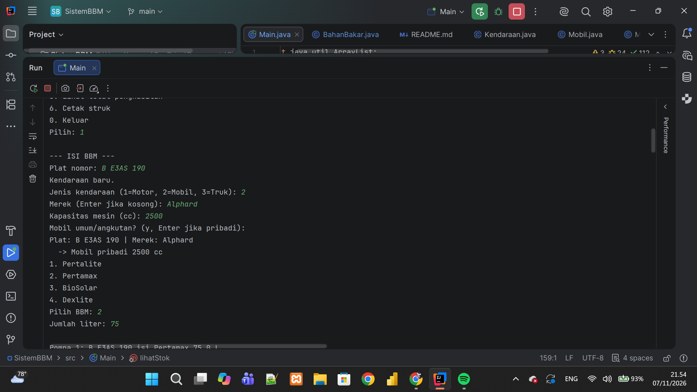
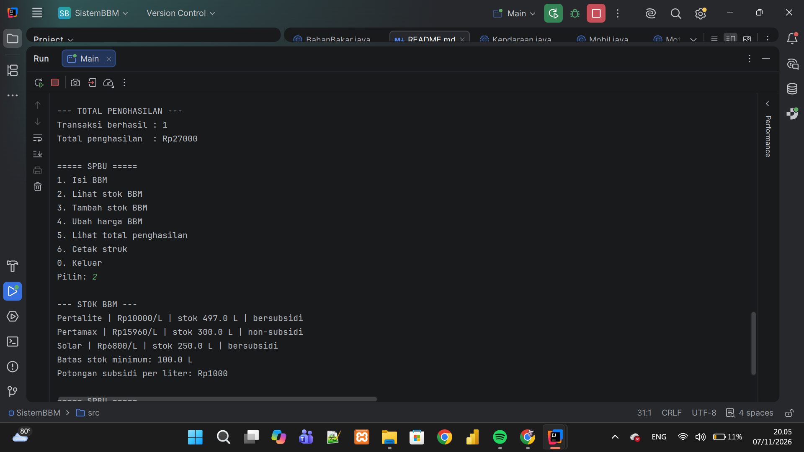
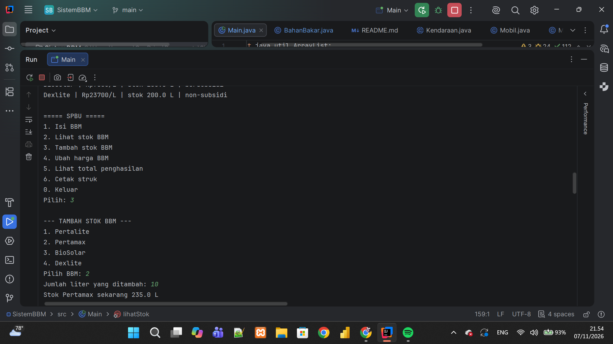
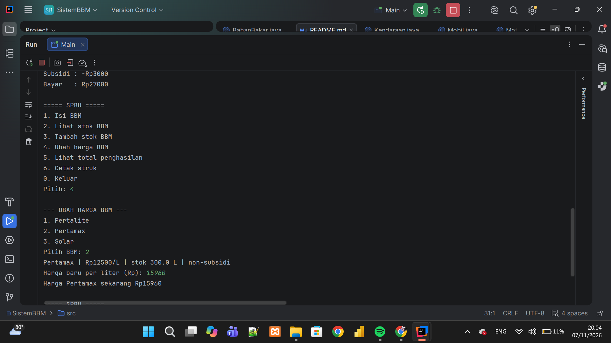
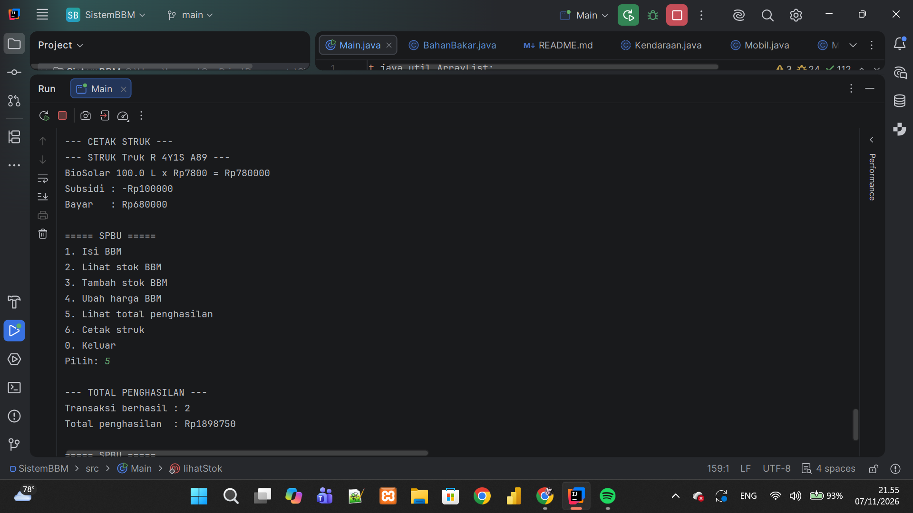
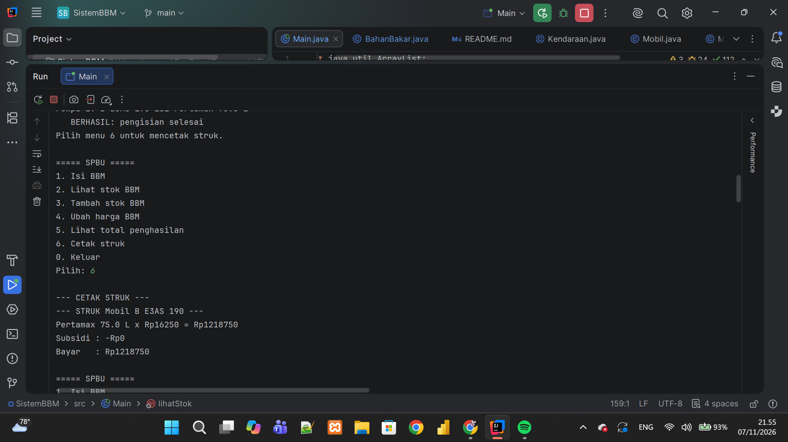

# Sistem Manajemen SPBU 
## Identitas Mahasiswa
*   **Nama:** Hafizh Fauzan
*   **NIM:** H1D025092
*   **Shift KRS:** Shift B
*   **Shift Sekarang:** Shift C
*   **Tema:** SPBU 

## Penjelasan Singkat Sistem
Sistem ini adalah aplikasi *Command Line Interface* (CLI) berbasis Java yang menyimulasikan proses operasional dan transaksi di Stasiun Pengisian Bahan Bakar Umum (SPBU).

Fitur utama dalam sistem ini meliputi:
*   **Manajemen Kendaraan:** Pendaftaran dan identifikasi jenis kendaraan (Mobil Pribadi, Mobil Umum, Motor, Truk) beserta kapasitas mesin (cc).
*   **Manajemen Bahan Bakar:** Pengaturan stok dan harga untuk berbagai jenis BBM (Pertamax, Pertalite, Solar) baik yang bersubsidi maupun non-subsidi.
*   **Validasi Aturan Subsidi:** Sistem secara otomatis menolak pengisian jika kendaraan melebihi batas kuota harian BBM bersubsidi, tidak sesuai peruntukan (misal: motor mengisi diesel), atau melebihi batas maksimal kapasitas mesin (cc) yang diperbolehkan untuk BBM tertentu.
*   **Transaksi & Struk:** Kalkulasi otomatis total harga setelah potongan subsidi, pencatatan pendapatan SPBU, dan pencetakan bukti transaksi (struk). Fitur cetak struk hanya bisa dilakukan untuk riwayat satu transaksi pengisian bbm terakhir yang berhasil 

## Petunjuk Kompilasi dan Eksekusi (Compile & Run)

### 1. Menggunakan IntelliJ IDEA
1. Buka IntelliJ IDEA, pilih **Open**, dan arahkan ke folder proyek.
2. Pada panel *Project* di sebelah kiri, buka folder `src` dan klik ganda pada `src/Main.java`.
3. Klik ikon **Play** (segitiga hijau) di sebelah baris `public class Main`, lalu pilih **Run 'Main.main()'**.

### 2. Menggunakan Visual Studio Code (VS Code)
1. Buka VS Code, pilih **File > Open Folder**, dan pilih folder proyek.
2. Pastikan ekstensi **Extension Pack for Java** sudah terinstal.
3. Buka file `src/Main.java`.
4. Klik tombol **Run** di atas metode `main` atau ikon **Play** di pojok kanan atas.

## Screenshoot Output
1. **Isi BBM**

2. **Stok BBM**

3. **Restock BBM**

4. **Ubah Harga BBM**

5. **Total Penghasilan**

6. **Cetak Struk**
